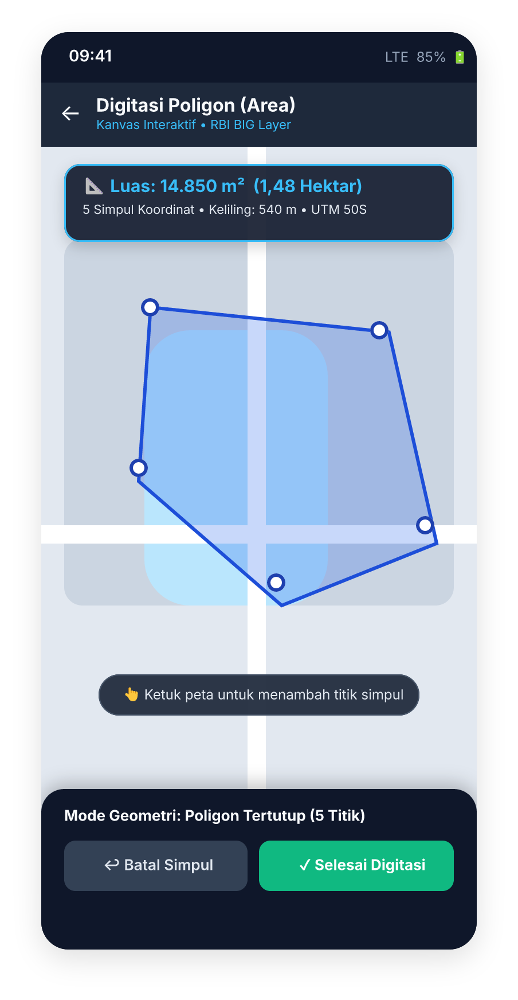
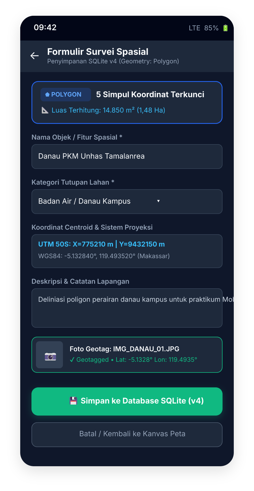
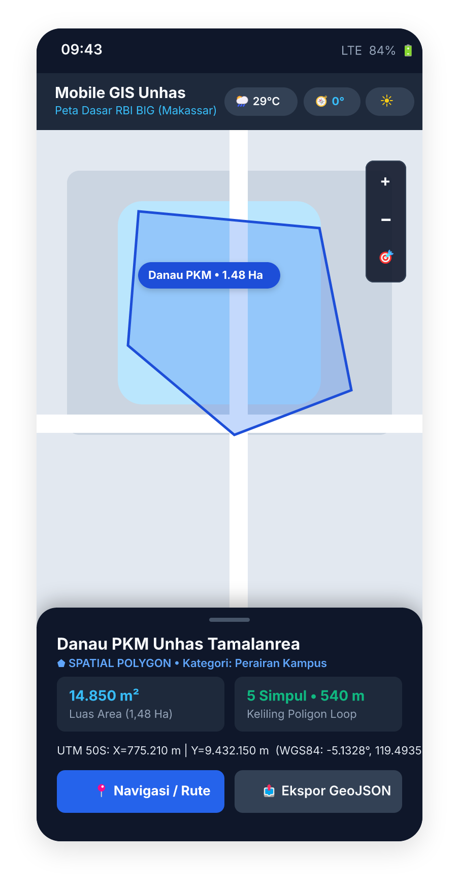
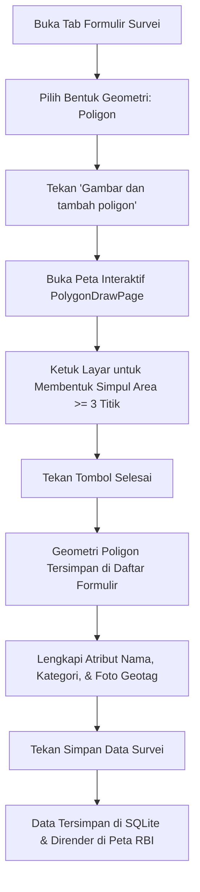

# 📐 Spesifikasi & Dokumentasi Fitur Poligon Spasial (Polygon Draw & Layer)

**Mata Kuliah:** Praktek Mobile GIS (2026)  
**Program Studi:** D4 Penginderaan Jauh & Sistem Informasi Geografis (PJ-SIG)  
**Fakultas:** Fakultas Vokasi, Universitas Hasanuddin  

### 👥 Anggota Kelompok Pengembang:
1. **M. Arief Abdillah** (NIM: V126241003) — *Visualisasi Overlay Peta Multi-Layer & Integrasi Basemap RBI BIG*
2. **Ashabul Kahfi** (NIM: V126241005) — *UI Digitasi Kanvas Spasial & Interaksi Pengguna (`polygon_draw_page.dart`)*
3. **Ariel Khan** (NIM: V126241001) — *Integrasi Skema Database & Migrasi SQLite v4 (`database_helper.dart` & `survey_point.dart`)*

---

## 1. Desain Antarmuka & Tangkapan Layar (FigCraft Showcase)

Fitur poligon dirancang untuk memberikan pengalaman akuisisi data spasial yang presisi dan intuitif di perangkat mobile.

### 📱 Tiga Tampilan Utama Antarmuka:

| 1. Kanvas Digitasi Interaktif | 2. Formulir Survei Spasial | 3. Visualisasi Peta Digital |
|:---:|:---:|:---:|
|  |  |  |
| `polygon_draw_page.dart` | `survey_form_page.dart` | `map_page.dart` |
| Simpul interaktif, garis loop otomatis, undo titik, dan kalkulasi luas area seketika (1,48 Ha). | Mode geometri `POLYGON`, penguncian 5 simpul, nama fitur, dan dual koordinat UTM 50S. | Render `PolygonLayer` di atas Peta Dasar RBI BIG, rotasi utara (0°), dan popup detail info. |

---

## 2. Tabel Perbandingan Sebelum dan Sesudah Perubahan

| Komponen Arsitektur | Kondisi Sebelumnya | Sesudah Pembaruan Fitur Poligon |
|---|---|---|
| **Dukungan Geometri** | Hanya mendukung titik tunggal (*Single Point*). | Mendukung **Titik (Point)**, **Garis (Line)**, dan **Poligon (Polygon)** secara modular. |
| **Antarmuka Input Spasial** | Hanya tombol "Kunci Lokasi GPS". | Terdapat dropdown pilihan geometri + tombol **"Gambar dan tambah poligon"** yang membuka kanvas peta interaktif. |
| **Kanvas Digitasi Area** | Belum tersedia kanvas interaktif. | Halaman khusus **`PolygonDrawPage`** dengan fitur tap titik, undo simpul terakhir, reset, dan validasi minimal 3 titik. |
| **Penyimpanan Database** | Tabel `survey_points` hanya menyimpan kolom `latitude` & `longitude`. | Ditambahkan kolom `polygon_json`, `geometry_type`, dan `geometry_json` untuk menyimpan seluruh array koordinat simpul poligon. |
| **Migrasi Database** | Database versi 2 / 3. | Database dinaikkan ke **Versi 4** dengan migrasi otomatis (*backward compatible* tanpa menghapus data survei lama). |
| **Visualisasi di Peta** | Hanya me-render marker pin lokasi. | Peta utama merender **`PolygonLayer`** (arsir biru transparan dengan border tegas) tepat di atas Peta Dasar RBI BIG. |

---

## 3. Rincian Implementasi Berkas Kode (*Source Code*)

### A. Halaman Kanvas Digitasi Baru: `lib/screens/polygon_draw_page.dart`
* Pengguna mengetuk layar (*tap*) untuk meletakkan titik-titik pembentuk poligon.
* Menampilkan garis poligon dinamis dan nomor urut simpul (*vertex avatar 1, 2, 3...*).
* Dilengkapi tombol aksi:
  * **Undo**: Membatalkan titik koordinat terakhir (`removeLast()`).
  * **Hapus Semua**: Mengosongkan kanvas digitasi (`_points.clear()`).
* Tombol **Selesai** hanya aktif jika syarat minimum pembentukan poligon terpenuhi ($\ge 3$ titik koordinat), lalu mengembalikan `List<LatLng>` ke formulir pemanggil.

### B. Perluasan Model Data: `lib/models/survey_point.dart`
* Menambahkan `enum SurveyGeometryType { point, line, polygon }`.
* Menambahkan kelas representasi fitur spasial:
  ```dart
  class SurveyFeature {
    final SurveyGeometryType type;
    final List<LatLng> points;
    // toMap() & fromMap() serialisasi JSON
  }
  ```
* Memperbarui kelas `SurveyPoint` dengan properti `geometryFeatures` dan accessor `polygonPoints`.
* Serialisasi JSON menyimpan array koordinat ke database lokal dalam format `[ [lat, lon], [lat, lon], ... ]`.

### C. Pembaruan Skema Database: `lib/db/database_helper.dart`
* Menaikkan versi database dari versi 2/3 menjadi **Versi 4**.
* Menambahkan skema kolom baru pada tabel `survey_points`:
  * `polygon_json TEXT NOT NULL DEFAULT '[]'`
  * `geometry_type TEXT NOT NULL DEFAULT 'point'`
  * `geometry_json TEXT NOT NULL DEFAULT '[]'`
* Menambahkan fungsi migrasi cerdas pada `onUpgrade` dengan query `PRAGMA table_info(survey_points)` untuk memastikan kolom baru ditambahkan tanpa merusak data survei lama mahasiswa lain.

### D. Formulir Survei Lapangan: `lib/screens/survey_form_page.dart`
* Dropdown pilihan bentuk geometri (*Titik, Garis, Poligon*).
* Logika navigasi `Navigator.push` menuju `PolygonDrawPage`.
* Daftar rekapitulasi fitur yang telah digambar beserta jumlah koordinat pembentuknya.

### E. Visualisasi Peta Utama: `lib/screens/map_page.dart`
* Mengintegrasikan `PolygonLayer` ke dalam tumpukan layer `FlutterMap`.
* Setiap poligon hasil survei dirender dengan konfigurasi kartografis yang jelas:
  * **Warna Isi (Fill Color)**: Biru transparan (`Colors.blue.withValues(alpha: 0.3)`).
  * **Warna Garis Tepi (Border Color)**: `Colors.blueAccent` dengan ketebalan 2.5 px.
* Diposisikan di atas **TileLayer Peta Dasar Rupabumi Indonesia (RBI BIG)** yang telah diintegrasikan oleh M. Arief Abdillah.

---

## 4. Potongan Kode Implementasi Kunci

### 1. Validasi & Pengembalian Titik Poligon (`polygon_draw_page.dart`)
```dart
void _finishDrawing() {
  if (_points.length < _minimumPoints) return; // Minimal 3 titik untuk Poligon
  Navigator.of(context).pop(List<LatLng>.unmodifiable(_points));
}
```

### 2. Rendering PolygonLayer pada Peta Utama (`map_page.dart`)
```dart
PolygonLayer(
  polygons: [
    for (final point in _savedPoints)
      for (final feature in point.geometryFeatures)
        if (feature.type == SurveyGeometryType.polygon && feature.points.length >= 3)
          Polygon(
            points: feature.points,
            color: Colors.blue.withValues(alpha: 0.3),
            borderColor: Colors.blueAccent,
            borderStrokeWidth: 2.5,
          ),
  ],
),
```

### 3. Migrasi Skema SQLite Versi 4 (`database_helper.dart`)
```dart
if (!names.contains('polygon_json')) {
  await db.execute(
    "ALTER TABLE survey_points ADD COLUMN polygon_json TEXT NOT NULL DEFAULT '[]'",
  );
}
if (!names.contains('geometry_type')) {
  await db.execute(
    "ALTER TABLE survey_points ADD COLUMN geometry_type TEXT NOT NULL DEFAULT 'point'",
  );
}
```

---

## 5. Alur Penggunaan Operasional Lapangan (*User Workflow*)


